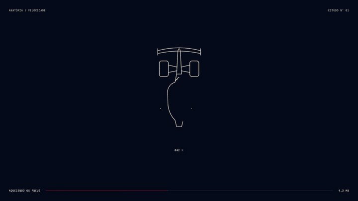
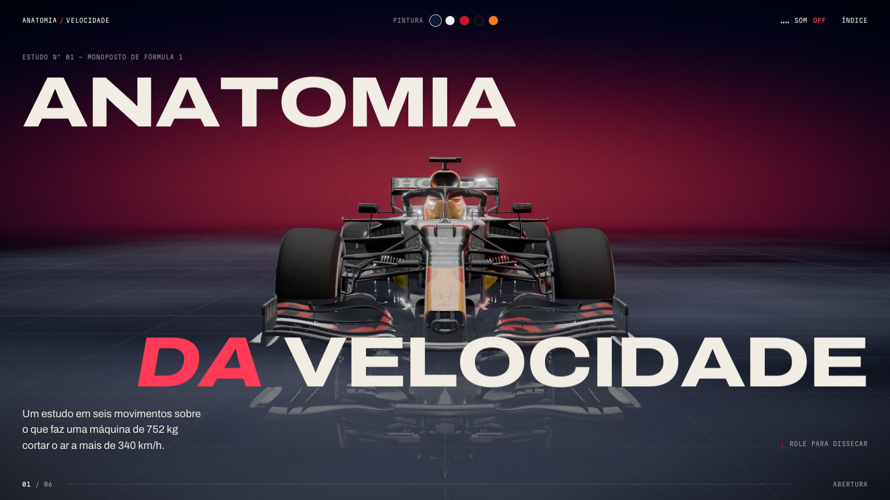
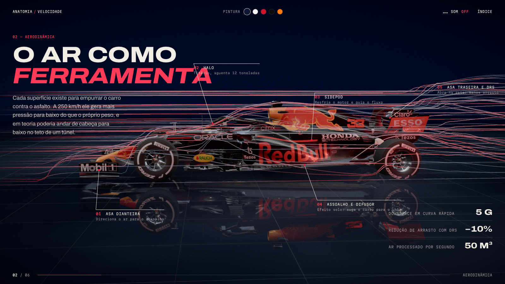
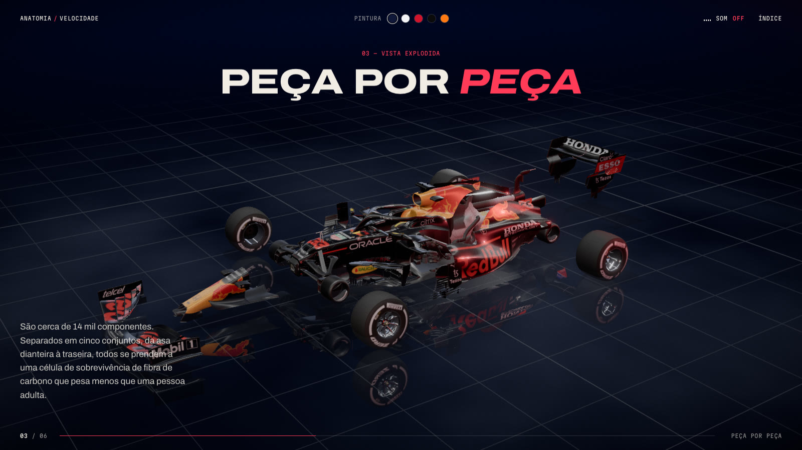
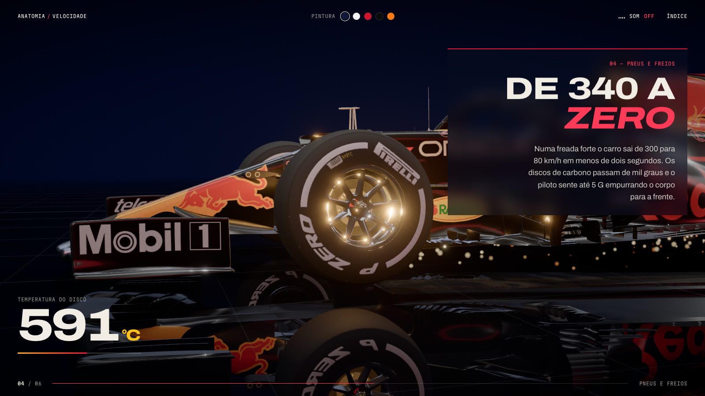
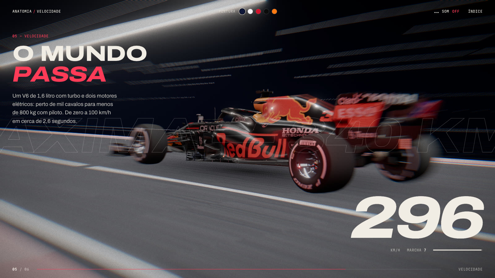
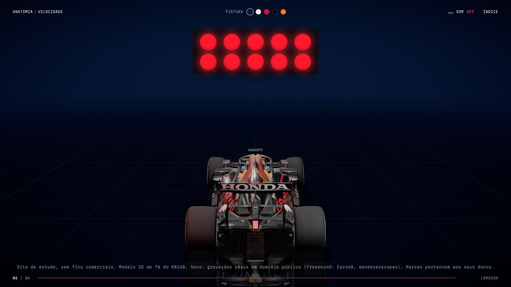

<div align="center">

# ANATOMIA DA VELOCIDADE

**Um site 3D imersivo sobre um carro de Fórmula 1, contado pela rolagem.**

[**▶ Ver o site no ar**](https://alexfanis.github.io/anatomia-da-velocidade/)

<a href="https://alexfanis.github.io/anatomia-da-velocidade/"></a>

`Three.js` · `GLSL` · `GSAP` · `Lenis` · `Howler.js` · `Vite`

</div>

---

Uma única cena 3D contínua, sem cortes: a câmera "pilota" em volta do carro conforme a página desce, e cada seção revela um aspecto dele, da aerodinâmica à largada.

## Seis movimentos

<table>
  <tr>
    <td width="50%"></td>
    <td width="50%"></td>
  </tr>
  <tr>
    <td><b>01 · Abertura</b><br/>Um F1 em traço se desenha durante o carregamento e dispara; a cena surge por uma máscara de ruído.</td>
    <td><b>02 · Aerodinâmica</b><br/>Linhas de fluxo de ar contornam asa, sidepods e asa traseira, com rótulos técnicos presos às peças.</td>
  </tr>
  <tr>
    <td></td>
    <td></td>
  </tr>
  <tr>
    <td><b>03 · Peça por peça</b><br/>Vista explodida em cinco conjuntos, cada um num eixo reto. Rolar de volta remonta o carro.</td>
    <td><b>04 · Pneus e freios</b><br/>Close na roda, disco de carbono ficando incandescente e faíscas saindo sob o assoalho.</td>
  </tr>
  <tr>
    <td></td>
    <td></td>
  </tr>
  <tr>
    <td><b>05 · Velocidade</b><br/>O carro fica parado e o mundo passa: pista, túnel de luzes, motion blur e velocímetro até 340 km/h.</td>
    <td><b>06 · Largada</b><br/>As cinco luzes acendem e se apagam juntas, ao som de uma largada real de F1.</td>
  </tr>
</table>

## Detalhes

- **Interação:** arrastar gira o carro com inércia, troca de pintura ao vivo com varredura animada, cursor magnético e distorção de calor que segue o mouse.
- **Pós-processamento:** bloom, blur radial e aberração cromática ligados à velocidade, granulado de filme e vinheta, tudo com efeitos GLSL próprios.
- **Som:** gravações reais de um Red Bull Renault V8; o ronco muda de giro conforme a rolagem.
- **Desempenho:** 60 fps no desktop, com sombras recalculadas só quando o carro se mexe e resolução adaptativa.
- **Modelo:** otimizado com [glTF Transform](https://gltf-transform.dev), de 16 MB para 4,5 MB (meshopt + WebP).
- **Acessibilidade:** respeita `prefers-reduced-motion` e mantém o texto legível mesmo sem WebGL.

## Rodar localmente

```sh
npm install
npm run dev
```

Para publicar no GitHub Pages: `npm run publicar`.

## Créditos

- Projeto de estudo, sem fins comerciais. Modelo 3D de fã do RB16B; as marcas e logos pertencem aos seus donos.
- Sons: gravações em domínio público (CC0) do Freesound — [Ears68](https://freesound.org/people/Ears68/sounds/181187/) (Red Bull Renault V8, 2012; GP da Austrália 2012) e [wandererscapes](https://freesound.org/people/wandererscapes/sounds/410894/) (Monza 2014).
- Fontes: Archivo e Martian Mono (SIL Open Font License).
